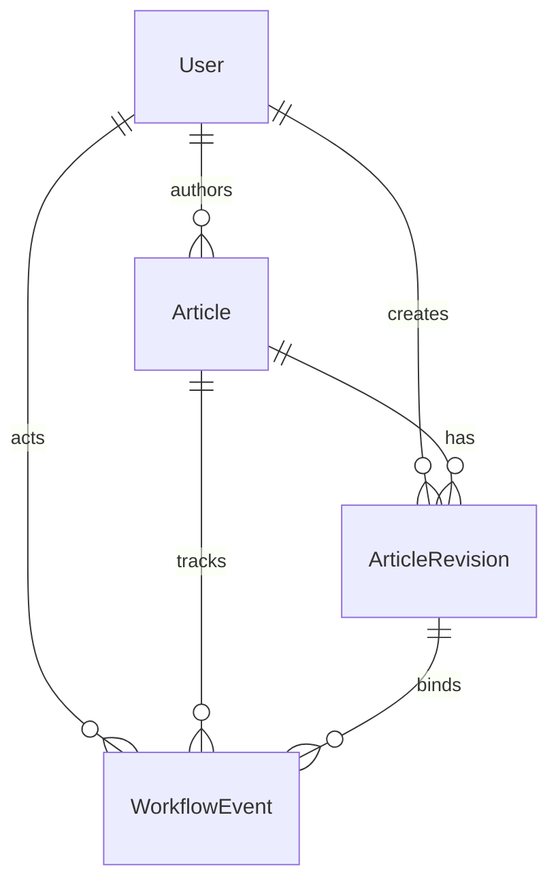

# Data Model: Core Blog & Editorial Workflow

**Feature**: 001-core-blog-workflow
**Date**: 2026-10-19
**Based on**: [spec.md](spec.md), [research.md](research.md)

---

## Entity Relationship Diagram



---

## Core Models

### 1. User (`accounts.models.User`)

Extends `AbstractUser` with role-based authorization.

| Field | Type | Constraints | Description |
|-------|------|-------------|-------------|
| `id` | `BigAutoField` | PK | Primary key |
| `username` | `CharField(100)` | Unique, not null | Login identifier |
| `password` | `CharField(255)` | Not null | BCrypt hash (Django auth) |
| `role` | `CharField(20)` | Choices: `AUTHOR`, `EDITOR`, `ADMIN`; not null | Authorization role |
| `is_active` | `BooleanField` | Default: `True` | Soft delete flag |
| `created_at` | `DateTimeField` | Auto_now_add | Record creation |
| `updated_at` | `DateTimeField` | Auto_now | Last modification |

**Indexes**: `username` (unique), `role`

**Methods**:
```python
@property
def is_admin(self) -> bool:
    return self.role == self.Role.ADMIN

@property
def is_editor(self) -> bool:
    return self.role == self.Role.EDITOR

@property
def is_author(self) -> bool:
    return self.role == self.Role.AUTHOR

def can_manage_users(self) -> bool:
    return self.is_admin

def can_publish(self) -> bool:
    return self.is_admin

def can_editorial_review(self) -> bool:
    return self.is_editor or self.is_admin
```

**Constraints**:
- At least one active Admin must exist (enforced at application level)
- Users are never hard-deleted; `is_active=False` preserves FK integrity

---

### 2. Article (`blog.models.Article`)

Represents a blog post with workflow state.

| Field | Type | Constraints | Description |
|-------|------|-------------|-------------|
| `id` | `BigAutoField` | PK | Primary key |
| `author` | `ForeignKey(User)` | PROTECT, not null, `related_name='articles'` | Content owner |
| `status` | `CharField(30)` | Choices: `Status`; default: `DRAFT`; not null | Workflow state |
| `current_revision` | `PositiveIntegerField` | Default: `0`; not null | Latest revision number |
| `published_at` | `DateTimeField` | Null, blank | Publication timestamp |
| `created_at` | `DateTimeField` | Auto_now_add | Record creation |
| `updated_at` | `DateTimeField` | Auto_now | Last modification |

**Indexes**:
- `status` (for queue queries)
- `author_id` (for author dashboard)
- `created_at` (for ordering)

**Status Enum**:
```python
class Status(models.TextChoices):
    DRAFT = 'DRAFT', 'پیش‌نویس'
    IN_EDITORIAL_REVIEW = 'IN_EDITORIAL_REVIEW', 'در بررسی ویراستار'
    CHANGES_REQUESTED = 'CHANGES_REQUESTED', 'تغییر درخواست شده'
    PENDING_ADMIN_APPROVAL = 'PENDING_ADMIN_APPROVAL', 'در انتظار تأیید مدیر'
    PUBLISHED = 'PUBLISHED', 'منتشرشده'
```

**Methods**:
```python
def can_be_edited_by(self, user: User) -> bool:
    """Author, Editor, or Admin can edit drafts/changes-requested"""
    if user.is_admin or user.is_editor:
        return True
    return self.author_id == user.id

def can_be_viewed_by(self, user: User | None) -> bool:
    """Published articles visible to all; others only to authorized"""
    if self.status == self.Status.PUBLISHED:
        return True
    if user is None:
        return False
    return self.can_be_edited_by(user)

def get_current_revision(self) -> ArticleRevision | None:
    """Return the current revision object"""
    if self.current_revision == 0:
        return None
    return self.revisions.filter(revision_number=self.current_revision).first()

def is_editable(self) -> bool:
    """Only DRAFT and CHANGES_REQUESTED are editable"""
    return self.status in [self.Status.DRAFT, self.Status.CHANGES_REQUESTED]

def is_in_review(self) -> bool:
    return self.status in [self.Status.IN_EDITORIAL_REVIEW, self.Status.PENDING_ADMIN_APPROVAL]
```

**Validation Rules**:
- `status` transitions only via workflow service (not direct assignment)
- `current_revision` increments only when new `ArticleRevision` created
- `published_at` set only on `PUBLISH` transition; cleared on `UNPUBLISH`

---

### 3. ArticleRevision (`blog.models.ArticleRevision`)

Immutable snapshot of article content at a point in time.

| Field | Type | Constraints | Description |
|-------|------|-------------|-------------|
| `id` | `BigAutoField` | PK | Primary key |
| `article` | `ForeignKey(Article)` | CASCADE, not null, `related_name='revisions'` | Parent article |
| `revision_number` | `PositiveIntegerField` | Not null | Sequential per article |
| `title` | `CharField(255)` | Not null | Article title |
| `slug` | `SlugField(255)` | Unique globally, not null | URL identifier |
| `excerpt` | `TextField` | Blank allowed | Summary/teaser |
| `body_markdown` | `TextField` | Not null | Markdown source |
| `tags` | `TextField` | Blank allowed | Comma-separated or JSON array |
| `created_by` | `ForeignKey(User)` | PROTECT, not null, `related_name='revisions'` | Editor of this revision |
| `created_at` | `DateTimeField` | Auto_now_add | Revision timestamp |

**Indexes**:
- `article_id`, `revision_number` (unique together)
- `slug` (unique globally)
- `created_by_id`

**Constraints**:
- `(article, revision_number)` unique — enforced at DB level
- `slug` globally unique — enforced at DB level
- Immutable after creation (no `save()` override; updates create new revision)

**Methods**:
```python
def get_sanitized_html(self) -> str:
    """Render markdown to safe HTML"""
    from core.utils import markdown_to_safe_html
    return markdown_to_safe_html(self.body_markdown)

def get_tags_list(self) -> list[str]:
    """Parse tags field into list"""
    if not self.tags:
        return []
    return [t.strip() for t in self.tags.split(',') if t.strip()]

def has_content_changes(self, other: 'ArticleRevision') -> bool:
    """Compare content fields (excluding metadata)"""
    return (
        self.title != other.title or
        self.slug != other.slug or
        self.excerpt != other.excerpt or
        self.body_markdown != other.body_markdown or
        self.tags != other.tags
    )
```

**Validation Rules**:
- `title` and `body_markdown` required (validated in form)
- `slug` auto-generated from `title` if blank; must be unique
- Content changes create new revision; metadata-only saves do not

---

### 4. WorkflowEvent (`workflow.models.WorkflowEvent`)

Append-only audit log of all workflow transitions.

| Field | Type | Constraints | Description |
|-------|------|-------------|-------------|
| `id` | `BigAutoField` | PK | Primary key |
| `article` | `ForeignKey(Article)` | CASCADE, not null, `related_name='workflow_events'` | Subject article |
| `revision` | `ForeignKey(ArticleRevision)` | SET_NULL, null, blank, `related_name='workflow_events'` | Bound revision (if applicable) |
| `actor` | `ForeignKey(User)` | PROTECT, not null, `related_name='workflow_events'` | User who performed action |
| `action` | `CharField(40)` | Choices: `Action`; not null | Action type |
| `from_status` | `CharField(30)` | Choices: `Article.Status`; null, blank | Previous status |
| `to_status` | `CharField(30)` | Choices: `Article.Status`; null, blank | New status |
| `note` | `TextField` | Blank allowed | Human-readable reason |
| `created_at` | `DateTimeField` | Auto_now_add | Event timestamp |

**Indexes**:
- `article_id`, `created_at` (for history display)
- `actor_id` (for user activity)

**Action Enum**:
```python
class Action(models.TextChoices):
    CREATE = 'CREATE', 'ایجاد'
    UPDATE_CONTENT = 'UPDATE_CONTENT', 'ویرایش محتوا'
    SUBMIT_FOR_REVIEW = 'SUBMIT_FOR_REVIEW', 'ارسال برای بررسی'
    REQUEST_CHANGES = 'REQUEST_CHANGES', 'درخواست تغییر'
    APPROVE_EDITORIAL = 'APPROVE_EDITORIAL', 'تأیید ویراستاری'
    REJECT_EDITORIAL = 'REJECT_EDITORIAL', 'رد ویراستاری'
    PUBLISH = 'PUBLISH', 'انتشار'
    UNPUBLISH = 'UNPUBLISH', 'لغو انتشار'
    ASSIGN_ROLE = 'ASSIGN_ROLE', 'انتساب نقش'
    DEACTIVATE_USER = 'DEACTIVATE_USER', 'غیرفعال‌سازی کاربر'
```

**Validation Rules**:
- `revision` required for `UPDATE_CONTENT`, `SUBMIT_FOR_REVIEW`, `APPROVE_EDITORIAL`, `PUBLISH`
- `note` required for `REQUEST_CHANGES`, `REJECT_EDITORIAL`, `UNPUBLISH`
- `from_status` → `to_status` must be valid transition per PRD-01 Section 6
- Events never deleted or modified (append-only)

---

## Abstract Base Model

### TimeStampedModel (`core.models.TimeStampedModel`)

```python
class TimeStampedModel(models.Model):
    created_at = models.DateTimeField(auto_now_add=True, verbose_name='تاریخ ایجاد')
    updated_at = models.DateTimeField(auto_now=True, verbose_name='تاریخ به‌روزرسانی')

    class Meta:
        abstract = True
        ordering = ['-created_at']
```

Used by: `Article`, `ArticleRevision`, `WorkflowEvent` (User has its own via AbstractUser)

---

## Migration Strategy

### Initial Migration Order

1. `accounts` — User model (depends on `auth`, `contenttypes`)
2. `blog` — Article, ArticleRevision (depends on `accounts`)
3. `workflow` — WorkflowEvent (depends on `blog`, `accounts`)

### Migration Naming

- `0001_initial.py` — Auto-generated
- `0002_add_*_constraints.py` — Manual: unique constraints, check constraints
- `0003_add_*_indexes.py` — Manual: composite indexes for query performance

### Data Migrations

- None required for MVP (bootstrap Admin via management command)

---

## Validation Summary

| Requirement | Implementation |
|-------------|----------------|
| FR-003: Server-side RBAC | `User.role` + permission mixins in views |
| FR-005: Last Admin protection | `UserManager.deactivate()` checks `Admin.objects.filter(is_active=True).count()` |
| FR-006: Secure passwords | Django `AbstractUser` uses `PBKDF2` (configurable to `BCrypt` via `PASSWORD_HASHERS`) |
| FR-009: Revision on content change | `ArticleRevision.has_content_changes()` in form/service |
| FR-020: Immutable revisions | No `update()` on revision; new revision created |
| FR-021: Append-only workflow log | `WorkflowEvent` no `save()` override; no delete permission |
| FR-022: Revision-bound approval | `WorkflowEvent.revision` FK; `RevisionBoundActionMixin` |
| FR-023: Markdown sanitization | `ArticleRevision.get_sanitized_html()` uses `bleach` |
| FR-024: Unique slugs | `ArticleRevision.slug` unique=True |
| FR-030: Migrations for schema | Django migrations per app |

---

## Future Extensibility (PRD-02/03)

| Extension | Model Changes |
|-----------|---------------|
| AI-generated drafts | Add `source` field to `ArticleRevision` (enum: `HUMAN`, `AI_GENERATED`, `AI_ASSISTED`) |
| AI editorial review | Add `WorkflowEvent.ai_provider`, `ai_model`, `ai_prompt_hash` |
| AI assistant queries | New model `AssistantQuery` (user, question, answer, context_articles, created_at) |
| Scheduled publishing | Add `scheduled_at` to `Article`; new status `SCHEDULED` |

No schema changes required in this phase — designed for additive extensions.